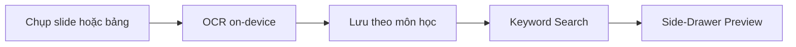

# 01 — Project Direction and Rationale

> *Trang này chứa Mục 1 và Mục 2 trong khung 13 mục của Assignment 1.*
>
> **Quy ước đọc:** Trang 01 trình bày **giả định và định hướng ban đầu** của nhóm, sau đó ghi nhận định hướng được điều chỉnh khi có khảo sát. Giả định ban đầu có thể không trùng với kết luận nghiên cứu.

---

## Mục 1: Project Direction (Định hướng dự án)

### Bài toán cần giải quyết — giả định ban đầu

Nhóm khởi đầu từ quan sát rằng sinh viên thường **chụp ảnh slide, bảng trắng hoặc sơ đồ** khi học nhưng khó truy xuất lại nội dung sau đó. Ảnh học tập có thể bị trộn với ảnh cá nhân trong thư viện, và việc chỉ lướt theo thời gian chụp có thể không thuận tiện khi người học chỉ nhớ một khái niệm cụ thể.

**Giả định ban đầu (Initial Problem Hypothesis):** Rào cản quan trọng là nội dung văn bản nằm trong ảnh khó được khai thác như dữ liệu có thể tìm kiếm, hay nhóm gọi là hiện tượng *“text chết”*. Nhóm dự đoán **OCR + keyword search** có thể giúp tìm lại ảnh nhanh hơn duyệt thủ công. Đây là **giả thuyết sản phẩm**, không phải kết luận đã được khảo sát xác nhận.

**Đối chiếu với dữ liệu sau đó:** Trong file khảo sát đã đối chiếu, có 12 phản hồi tổng, trong đó 10 người trả lời các câu hỏi chính. Ở câu hỏi nhiều lựa chọn, 8/10 chọn khó nhớ vị trí/ngày chụp, 7/10 chọn ảnh học lẫn ảnh cá nhân và 3/10 chọn vấn đề text trong ảnh không thể copy/search. Kết quả này gợi ý **vấn đề tổ chức và tìm lại ảnh rộng hơn giả định OCR-first**. Do mẫu nhỏ và câu hỏi tự báo cáo, những số liệu này chỉ là tín hiệu ban đầu, không đủ đại diện toàn bộ thị trường (xem Wiki 02, Mục 5).

### Đối tượng người dùng mục tiêu

**Nhóm người dùng dự kiến:** sinh viên đại học, ưu tiên nhóm Máy tính/CNTT và các ngành kỹ thuật có nhu cầu lưu lại nội dung bài giảng qua ảnh.

Lý do nhóm ban đầu lựa chọn phân khúc này:

- Tài liệu học tập có thể chứa định nghĩa, code, công thức và sơ đồ khiến việc chép tay hoặc ôn tập bằng ảnh gặp trở ngại.
- Một số sinh viên dùng điện thoại để chụp nội dung cần giữ lại và xem lại trong những buổi học hoặc kỳ ôn tập sau.
- Nhóm có điều kiện tiếp cận người dùng khối Máy tính/CNTT để phỏng vấn và thử nghiệm prototype.

**Giới hạn bằng chứng:** 10 người khai ngành trong mẫu hiện tại đều thuộc nhóm Máy tính/CNTT. Chưa có dữ liệu để kết luận thói quen này phổ biến tương tự ở Điện–Điện tử, Cơ khí, Y khoa hay các ngành khác; mở rộng đối tượng là bước nghiên cứu sau.

### Bối cảnh phát sinh vấn đề (scenario giả định, cần kiểm tra thực địa)

| Khi nào | Bối cảnh | Hành vi và khó khăn có thể xảy ra |
| --- | --- | --- |
| Trong giờ học | Giảng đường, phòng thực hành | Chụp nhanh slide/bảng bằng camera mặc định hoặc công cụ khác |
| Sau buổi học | Điện thoại chứa ảnh học tập xen lẫn ảnh đời sống | Khó nhớ ảnh thuộc môn nào, buổi nào hoặc được chụp lúc nào |
| Khi ôn tập | Ở nhà, thư viện hoặc nơi thuận tiện | Tìm lại ảnh theo chủ đề/từ khóa hoặc duyệt theo ngữ cảnh môn học |

**Lưu ý:** Khoảng cách “nhiều tuần đến nhiều tháng”, việc chụp “3–5 buổi/tuần” và thời gian tìm ảnh “10–15 phút” từng được nêu như thực tế phổ biến nhưng **không được chứng minh bởi file khảo sát hiện có**, nên không dùng làm fact trong phiên bản này.

### Hiện trạng giải quyết và các lựa chọn thay thế

| Phương án | Ưu điểm có thể có | Hạn chế cần kiểm chứng với người dùng |
| --- | --- | --- |
| **Thư viện ảnh mặc định** | Đã quen dùng, thao tác chụp/lưu đơn giản | Ảnh học tập có thể bị trộn với ảnh khác, khó duyệt theo môn/buổi |
| **Album/folder tạo thủ công** | Có thể tổ chức theo môn mà không cần app mới | Phải duy trì việc phân loại ảnh bằng tay |
| **Google Photos / Google Lens / Apple Photos** | Có những khả năng OCR, nhận dạng hoặc tìm kiếm tùy nền tảng/thiết bị | Cần đo mức phù hợp với workflow bài giảng, không giả định những ứng dụng này “không search được text” |
| **CamScanner và công cụ scan** | Hỗ trợ chụp tài liệu, xử lý ảnh, xuất file | Cần đối chiếu thực tế thao tác tổ chức và tìm tài liệu học tập |
| **Apple Notes / Google Keep / Notion** | Ghi chú, tổ chức và liên kết tài liệu | Khác biệt về thao tác nhập ảnh và truy xuất trong bối cảnh học tập cần kiểm chứng |

Phân tích cạnh tranh ở đây là **định hướng nghiên cứu**. Kết luận về tính năng, giá, trạng thái sản phẩm và năng lực từng đối thủ phải được kiểm tra trên phiên bản cụ thể, theo kế hoạch ở Wiki 02, Mục 6.

### Hướng giải pháp đề xuất ban đầu (Initial Solution Hypothesis)

Nhóm từng đề xuất ứng dụng di động tập trung vào *post-scan workflow*:

Các lựa chọn được hình dung ban đầu:

- **On-device OCR**, dự kiến thử nghiệm với Google ML Kit, để lập chỉ mục chữ trong ảnh.
- **Keyword search** để người học tìm lại ảnh theo khái niệm thay vì chỉ theo ngày chụp.
- **Quản lý theo môn học** nhằm giảm ảnh bài giảng bị trộn với ảnh cá nhân.
- **Side-Drawer Preview** như một phương án xem nhanh kết quả tìm kiếm.
- **Local-first**, ưu tiên lưu dữ liệu và tra cứu trên máy khi offline.

Những chi tiết như *search dưới 1 giây*, độ chính xác OCR, phân loại “tự động”, hoặc UX ưu việt của Side-Drawer là **mục tiêu/giả thuyết cần test**, không phải hiệu quả đã được xác nhận. Gán môn thủ công không đồng nghĩa với auto-classification.

### Quá trình thay đổi định hướng sau nghiên cứu (Evolution of Project Direction)

Ý tưởng sơ khởi là **ứng dụng ghi chú tích hợp OCR**. Nhóm tiếp tục thu hẹp sang **công cụ quản lý và tìm lại ảnh tài liệu học tập**, thay vì xây dựng một app ghi chú tổng quát.

Khi khảo sát ban đầu cho thấy các vấn đề về **vị trí ảnh** và **ảnh học tập lẫn ảnh cá nhân** được lựa chọn nhiều hơn riêng vấn đề text không tìm kiếm được, nhóm **điều chỉnh giả thuyết**:

| Khía cạnh | Định hướng OCR-first ban đầu | Định hướng hiện tại để kiểm chứng |
| --- | --- | --- |
| **Problem** | Text trong ảnh khó tìm kiếm | Khó tổ chức, định vị và tìm lại ảnh bài giảng |
| **Input** | Chụp trong app | Chụp mới **hoặc** nhập từ Gallery |
| **Retrieval** | Chủ yếu keyword search | Kết hợp browse theo môn/ngày và keyword search |
| **Organization** | Tự động nhóm ảnh | MVP bắt đầu bằng gán môn thủ công; nghiên cứu grouping tự động sau |
| **Preview** | Side-Drawer cố định | Quick Preview; chưa khóa phương án UI |
| **Success** | Search có độ trễ thấp | Tìm **đúng ảnh** nhanh hơn, với tổng công sức ít hơn |

---

## Mục 2: Mobile Product Rationale (Lập luận vì sao chọn Mobile)

### Tác vụ & bối cảnh di động

Việc lưu ảnh bài giảng thường gắn với thiết bị sẵn có trong lớp học. Điện thoại là lựa chọn **phù hợp để thu nhận dữ liệu tại chỗ** vì có camera, thư viện ảnh và khả năng sử dụng khi không có máy tính. Tuy nhiên, đây **không phải nền tảng duy nhất** hỗ trợ camera hay lưu trữ offline: web và tablet cũng có khả năng tương tự ở các mức độ khác nhau.

Các tình huống mobile-first nhóm muốn hỗ trợ:

1. **Chụp mới:** Ghi lại slide/bảng trong thời gian ngắn mà không phải thao tác phức tạp.
2. **Nhập ảnh có sẵn:** Dùng lại ảnh từ Gallery thay vì buộc sinh viên thay đổi cách chụp quen thuộc.
3. **Tìm nhanh khi di chuyển:** Duyệt theo môn/ngày hoặc tìm keyword, xem ảnh và kiểm tra nội dung ngay trên điện thoại.
4. **Không có mạng:** Xem ảnh đã lưu và tìm trong chỉ mục cục bộ nếu quá trình OCR/lập chỉ mục đã hoàn thành.

### Khai thác khả năng của thiết bị di động

| Capability | Vai trò dự kiến | Lưu ý triển khai |
| --- | --- | --- |
| **Camera** | Chụp nhanh bài giảng | Cần test tốc độ thao tác; auto-crop chỉ là tính năng bổ sung nếu có giá trị |
| **Local Photo Library / Photo Picker** | Nhập ảnh đã có trong thư viện | Tránh yêu cầu quyền truy cập toàn bộ thư viện nếu không cần |
| **CPU / khả năng xử lý on-device** | Nhận diện chữ bằng ML Kit hoặc engine phù hợp | Đo accuracy, thời gian và pin; không yêu cầu mặc định mọi máy phải có NPU |
| **Local persistent storage** | Lưu ảnh, metadata, kết quả OCR và chỉ mục | Chọn công nghệ phù hợp stack cuối cùng (SQLite, Room hoặc giải pháp khác) |
| **Touch UI** | Browse, filter, search và xem nhanh ảnh | Side-Drawer chỉ là một trong các UI pattern có thể thử |

### Ràng buộc di động & cách tiếp cận

| Ràng buộc | Hướng xử lý dự kiến | Trạng thái |
| --- | --- | --- |
| **Màn hình nhỏ** | Danh sách/thumbnail gọn, Quick Preview hoặc mở ảnh chi tiết | UX cần thử với người dùng |
| **Pin và tài nguyên có hạn** | OCR ở background phù hợp, tránh quét lặp không cần thiết | Cần đo trên thiết bị thật |
| **Mạng không ổn định** | Ưu tiên lưu và lập chỉ mục cục bộ; các tính năng core hoạt động offline | Yêu cầu sản phẩm, cần test end-to-end |
| **Dung lượng lưu trữ hạn chế** | Chính sách lưu ảnh, thumbnail và metadata hợp lý; không cố định JPEG 80% trước khi đánh giá chất lượng | Quyết định kỹ thuật cần kiểm nghiệm |
| **Thiết bị phân mảnh** | Đặt min OS theo lựa chọn công nghệ và nhóm thiết bị thực tế | Chưa tuyên bố tỷ lệ phủ 95% nếu thiếu số liệu |

### Cân nhắc alternative platforms

| Platform | Điểm mạnh | Hạn chế trong workflow dự kiến | Kết luận tạm thời |
| --- | --- | --- | --- |
| **Mobile app** | Chụp/nhập ảnh và truy cập cục bộ thuận tiện | Màn hình nhỏ, tài nguyên hạn chế | **Ưu tiên cho MVP** |
| **Web/PWA** | Phân phối nhanh, có thể truy cập camera và lưu dữ liệu offline ở mức nhất định | Khả năng nền, lưu trữ và tích hợp thiết bị khác nhau theo browser/OS | Có thể là alternative; không loại trừ vì lý do công nghệ tuyệt đối |
| **Desktop** | Duyệt, tổng hợp tài liệu trên màn hình rộng thuận tiện | Không phải lựa chọn thuận tiện nhất để chụp nhanh trong lớp | Phù hợp workflow ôn tập/mở rộng |
| **Tablet** | Màn hình lớn, có camera và thao tác cảm ứng | Mức phổ biến trong nhóm mẫu chưa được đo | Có thể hỗ trợ về sau |
| **Smart watch** | Thiết bị đeo nhanh truy cập thông tin ngắn | Khó phù hợp tác vụ quản lý và đọc nhiều ảnh | Không ưu tiên |

**Kết luận:** Mobile là **lựa chọn thiết kế phù hợp** với giả thuyết về luồng thu nhận–tổ chức–tìm lại ảnh bài giảng. Điều này không có nghĩa OCR hoặc offline storage chỉ khả thi trên mobile.

### Đồng bộ đa nền tảng (cơ hội sau MVP)

Trong khảo sát hiện có, 4/10 người trả lời chọn muốn xuất/đồng bộ sang Google Docs/Notion, trong khi 6/10 chọn chỉ lưu và xem trên điện thoại. Đây là tín hiệu cần nghiên cứu sâu hơn về workflow ôn tập trên laptop, **không đủ để cam kết cloud sync trong MVP**.

- **MVP:** ưu tiên lưu trữ, phân loại, browse và search cục bộ trên mobile.
- **Sau MVP:** thử export đơn giản trước; nếu có nhu cầu thực tế rõ ràng mới cân nhắc OAuth, đồng bộ nhiều thiết bị và backend.

### Tổng kết: Mobile có cải thiện có ý nghĩa không?

**Giả thuyết của nhóm là có**, nhờ hội tụ camera, Photo Library, lưu trữ cục bộ, xử lý on-device và thao tác thuận tiện trong lớp học. Tuy nhiên, giá trị cần chứng minh không chỉ là *ứng dụng chạy trên điện thoại*, mà là **giúp sinh viên tìm đúng tài liệu học tập dễ hơn mà không tăng đáng kể công sức khi lưu ảnh**.

Nhóm sẽ xác thực bằng prototype và usability test, đối chiếu với các cách hiện tại như thư viện ảnh mặc định. Thước đo ưu tiên là **time-to-find đúng ảnh**, **task completion**, **organization effort** và **OCR accuracy theo loại nội dung**; những con số đặt trước chỉ là mục tiêu thử nghiệm.

---
