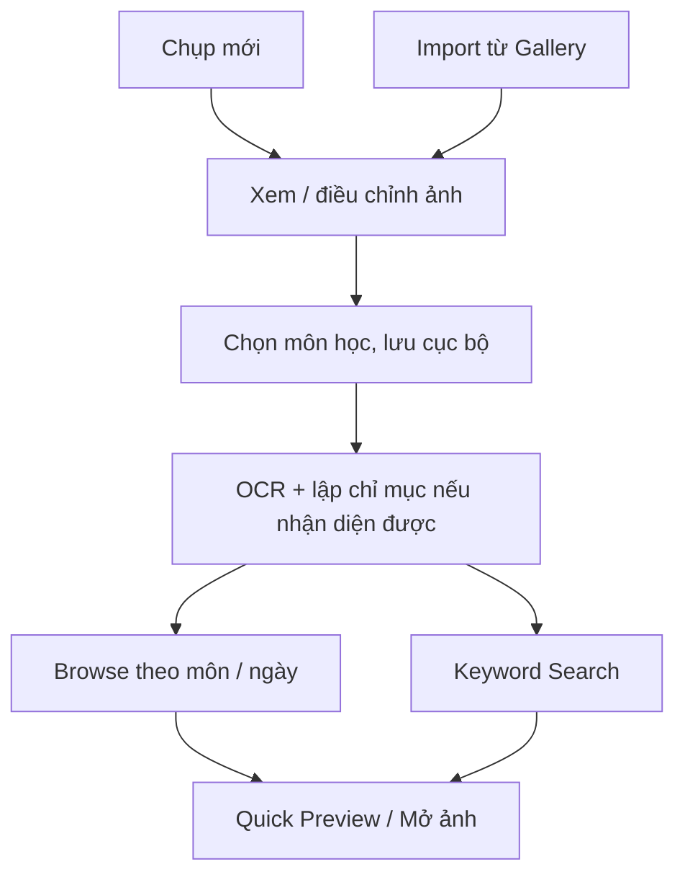

# 04 — MVP Scope and Implementation Plan

> Trang này chứa **Mục 9, 10, 11, 12, 13** trong khung 13 mục của Assignment 1.
>
> **Căn cứ:** Wiki 02 — Research Evidence and Decisions và Wiki 03 — Business Model Canva.

---

## Mục 9: Impact–Effort Matrix (Ma trận Tác động – Công sức)

### Nguyên tắc phân loại

- **Quick Wins:** Giá trị dự kiến cao, effort tương đối thấp, ưu tiên cho MVP.
- **Major Projects:** Giá trị tiềm năng cao nhưng effort/rủi ro lớn; chỉ triển khai sau khi core flow ổn định.
- **Fill-ins:** Có ích nhưng không quyết định khả năng giải quyết pain point.
- **Thankless / Out of Scope:** Không phục vụ mục tiêu tìm lại ảnh bài giảng trong phạm vi học kỳ.

> Phân loại là **ước lượng ban đầu của nhóm**, cần cập nhật sau spike kỹ thuật và usability test; không phải kết luận rút ra trực tiếp từ khảo sát.

### Quick Wins — Ưu tiên MVP

| # | Feature | Impact dự kiến | Effort dự kiến | Căn cứ/ghi chú |
| --- | --- | --- | --- | --- |
| 1 | **Gallery Import** | High | Low–Medium | D2/A4: cho phép dùng ảnh đã chụp; giảm yêu cầu thay đổi thói quen |
| 2 | **Quản lý theo môn học + duyệt danh sách** | High | Low–Medium | D3/A3: 8/10 khó nhớ vị trí/thời gian; 7/10 ảnh học lẫn ảnh cá nhân |
| 3 | **Tìm kiếm từ khóa trên OCR text** | High *nếu kiểm chứng được* | Medium | D1/A2: là một giả thuyết giải pháp, cần so sánh với browse |
| 4 | **Quick document preview đơn giản** | High | Low | D5: xác nhận đúng ảnh, không yêu cầu Side-Drawer |

### Core technical experiments — Làm sớm, không mặc định effort thấp

| # | Experiment / Capability | Mục tiêu | Rủi ro |
| --- | --- | --- | --- |
| 5 | **Google ML Kit OCR on-device** | Benchmark trên ít nhất 30 ảnh; lưu OCR text để search | Accuracy hạn chế với code, công thức, bảng viết tay; tích hợp framework cần spike |
| 6 | **Camera capture cơ bản** | Chụp ảnh ngay trong app, cho phép nhập ảnh vào cùng data model với Gallery | Permission, chất lượng ảnh và crop; auto-crop nâng cao có thể để sau |

### Major Projects — Defer hoặc chỉ làm sau khi được validate

| # | Feature | Lý do chưa ưu tiên |
| --- | --- | --- |
| 7 | **Auto-classification / Smart Session Clustering** | Cần dữ liệu/ngữ cảnh và benchmark độ chính xác; MVP dùng manual tagging |
| 8 | **Custom Side-Drawer Preview** | UX pattern cụ thể chưa test, effort animation/polish cao |
| 9 | **Export tích hợp Docs/Notion và cloud sync hai chiều** | D6/A5: 4/10 quan tâm đến export/sync, nhưng chưa xác thực workflow và effort OAuth/backend |

### Fill-ins — Khi core flow đã hoàn chỉnh

- Favorite/star và sắp xếp nâng cao; sort cơ bản theo thời điểm chụp đã nằm trong chức năng duyệt ảnh.
- Theme toggle.
- Xuất hoặc chia sẻ ảnh/text thủ công với hệ thống share sheet, nếu effort thấp.

### Out of Scope của MVP

- Scan giấy tờ tùy thân, hóa đơn, ký tên điện tử, dịch thuật thời gian thực.
- Nhận diện và chuyển đổi LaTeX phức tạp; hỗ trợ hoàn hảo chữ viết tay khó đọc.
- Collaboration, phân quyền nhiều người và cloud backup/sync hai chiều.

**Lý do ưu tiên:** Dữ liệu hiện có cho thấy nhu cầu *tổ chức và tìm lại ảnh* nổi bật hơn vấn đề không copy/search được text (**8/10, 7/10 so với 3/10**). Vì vậy phải test **browse và search**, không coi OCR là toàn bộ giá trị của sản phẩm.

---

## Mục 10: MVP Scope (Phạm vi MVP)

### Mục tiêu người dùng chính

> Giúp sinh viên **đưa ảnh bài giảng vào một thư viện có tổ chức và tìm lại đúng ảnh** bằng môn học/buổi học hoặc từ khóa, với ít công sức hơn cách sử dụng thư viện ảnh hiện tại.

### Core Value Path



- Chụp mới **và** import đều tạo ra cùng loại tài liệu; không bắt buộc user luôn mở camera trong app.
- **Manual subject tagging** ở MVP; không gọi là auto-classification.
- Nếu OCR lỗi, **vẫn lưu và duyệt được ảnh**; chỉ không có nội dung OCR để search.

### Danh sách tính năng MVP tối thiểu

| ID | Feature | Requirement cơ bản | User Story |
| --- | --- | --- | --- |
| **F1** | **Nhập ảnh** (Gallery + Camera) | Chọn ảnh có sẵn hoặc chụp mới; cho phép xem và xác nhận ảnh; auto-crop nâng cao tùy khả năng | US-01, US-02 |
| **F2** | **OCR offline + index** | Trích xuất text khi hỗ trợ, lưu ảnh và kết quả OCR local; OCR thất bại không làm mất ảnh | US-03 |
| **F3** | **Keyword search** | Tìm trên text OCR, hiển thị thumbnail và highlight khi khả thi | US-04 |
| **F4** | **Subject organization & browse** | Tạo/chọn/sửa môn, gắn nhãn thủ công, duyệt và lọc theo môn và ngày | US-05 |
| **F5** | **Quick preview** | Xem ảnh rõ, phóng to/đóng; không phụ thuộc Side-Drawer | US-06 |

### Ngoài MVP (có thể xem xét sau)

| ID | Feature | Quyết định |
| --- | --- | --- |
| X1 | Auto-classification theo AI / Smart Session Clustering | Defer; cần xác minh độ chính xác và lợi ích so với manual tag |
| X2 | Side-Drawer animation riêng | Chỉ làm nếu UX test cho thấy có lợi hơn màn hình preview đơn giản |
| X3 | Export Docs/Notion và sync backend | Defer theo A5/D6; có thể thử share/export đơn giản trước |
| X4 | OCR công thức LaTeX/chữ viết tay phức tạp | Không cam kết trong MVP |
| X5 | Scan văn phòng, dịch, ký điện tử | Không thuộc mục tiêu bài giảng |
| X6 | Multi-user, collaboration, cloud backup | Defer |

### Rủi ro và biện pháp giảm thiểu

| ID | Risk | Mitigation | Liên kết Wiki 02 |
| --- | --- | --- | --- |
| **R1** | OCR bỏ sót từ khóa trên ảnh thực tế | Benchmark 30+ ảnh; phân loại slide, code, công thức; vẫn lưu ảnh khi OCR fail | A1, D4 |
| **R2** | Keyword search không tốt hơn browse hay album mặc định | Task comparison within-subject; đo tìm đúng ảnh và median time | A2, D1 |
| **R3** | Manual tagging mất thời gian, không được dùng đều đặn | Đo số bước/tổng effort, cho phép đổi nhãn, mặc định danh sách gần đây | A3, D3 |
| **R4** | Chụp bằng app riêng gây friction | Gallery Import là luồng chính ngang hàng; đo theo tình huống thực tế | A4, D2 |
| **R5** | Chọn Side-Drawer gây phức tạp vượt lợi ích | Mặc định preview đơn giản; test trước khi custom | D5 |
| **R6** | Effort tích hợp camera/OCR/database với framework được chọn | Spike API + proof of concept sớm; chốt stack nhất quán | Kế hoạch kỹ thuật |

### Định nghĩa MVP thành công (success targets — **chưa đo**)

- [ ] Có thể import **và** chụp ảnh; lưu, gán môn, tìm/browse và xem ảnh end-to-end.
- [ ] Ít nhất 5–10 người dùng tham gia usability test; báo cáo cả số người, số tác vụ và tỷ lệ hoàn thành, không chỉ tổng phần trăm.
- [ ] Tỷ lệ tìm **đúng ảnh** trong các task chính mục tiêu ≥80%; báo cáo riêng search và browse.
- [ ] Median **time-to-find** mục tiêu giảm ≥50% khi so với tác vụ tương đương trên thư viện mặc định, không giảm tỷ lệ hoàn thành; đây là mục tiêu của A2, không phải lợi ích đã được chứng minh.
- [ ] OCR được benchmark trên ≥30 ảnh thực với mục tiêu accuracy ≥80% cho **văn bản thông thường**; phải xác định metric và báo cáo riêng code/công thức/bảng.
- [ ] SUS ≥70 là mục tiêu nghiên cứu UX, không phải kết quả đã đạt; app không crash trong phiên test 30 phút.
- [ ] Query latency <1 giây trên tập dữ liệu kiểm thử là **engineering target riêng**, không đồng nghĩa user tìm đúng ảnh dưới 1 giây.

---

## Mục 11: User Stories (Câu chuyện người dùng)

> Format: *As a [user], I want to [goal], so that [value].* Các acceptance criteria bên dưới là **đề xuất phải kiểm thử**.

### US-01: Import ảnh bài giảng từ Gallery

> **As a** sinh viên đã chụp ảnh bằng camera mặc định, **I want to** chọn ảnh cũ từ Gallery, **so that** tôi đưa tài liệu vào hệ thống mà không cần đổi thói quen chụp.

- **Traceability:** Evidence: 9/10 dùng thư viện ảnh mặc định → A4 → D2 → F1.
- **Acceptance:** Chọn và xem trước ảnh, hủy mà không lưu; ảnh được đưa vào cùng luồng xử lý như camera; không buộc cấp camera permission để import.

### US-02: Chụp nhanh ảnh bài giảng

> **As a** sinh viên đang học trên lớp, **I want to** chụp ảnh trực tiếp trong ứng dụng, **so that** tôi có thể lưu tài liệu ngay khi cần.

- **Traceability:** A4/D2 (hai nguồn ảnh) → F1.
- **Acceptance:** Xin quyền camera đúng lúc; chụp, retake, xác nhận ảnh và đi tới bước lưu; nếu không phát hiện biên vẫn cho lưu ảnh gốc.
- **Optional enhancement:** Auto-crop, sửa perspective; không cam kết accuracy khi chưa benchmark.

### US-03: OCR offline để hỗ trợ tìm kiếm

> **As a** sinh viên, **I want to** ứng dụng trích xuất chữ có thể nhận diện từ ảnh mà không cần Internet, **so that** tôi có thêm cách tìm lại ảnh bằng từ khóa.

- **Traceability:** A1 → D4 → F2.
- **Acceptance:** Trên thiết bị/framework mục tiêu, xử lý offline với model đã được chuẩn bị; lưu OCR text cùng document record; OCR fail không chặn lưu ảnh; hiển thị trạng thái OCR.

### US-04: Tìm lại ảnh bằng từ khóa

> **As a** sinh viên đang ôn tập, **I want to** gõ khái niệm từng xuất hiện trong slide, **so that** tôi có thể xác định ảnh liên quan mà không phải lướt toàn bộ album.

- **Traceability:** A2 → D1 → F3 (dùng text từ F2).
- **Acceptance:** Search trả kết quả từ local index, có thumbnail và link đến ảnh gốc; không có kết quả thì hỗ trợ chuyển sang browse. Query latency <1s là target kỹ thuật; time-to-find cần test riêng.

### US-05: Tổ chức và duyệt theo môn/buổi học

> **As a** sinh viên, **I want to** gắn nhãn môn học khi lưu và duyệt lại ảnh theo môn/thời gian, **so that** tôi không cần nhớ chính xác từ khóa hay ngày chụp.

- **Traceability:** 8/10 khó nhớ vị trí/ngày, 7/10 ảnh học trộn lẫn → A3 → D3 → F4.
- **Acceptance:** Tạo/chọn/đổi môn, duyệt và filter theo môn, sort theo ngày; đo tổng số thao tác, không gọi chức năng này là auto-classification.

### US-06: Xem nhanh và xác nhận đúng ảnh

> **As a** sinh viên đang tìm tài liệu, **I want to** mở preview để xem nội dung ảnh rõ ràng, **so that** tôi xác định đúng tài liệu trước khi tiếp tục ôn tập.

- **Traceability:** D5 → F5.
- **Acceptance:** Mở được ảnh ở kích thước đọc được, zoom và quay về danh sách giữ nguyên ngữ cảnh; có thể hiển thị OCR text nếu tồn tại. UI cụ thể do thử nghiệm quyết định.

### US-07 (Future): Export/Sync tài liệu

> **As a** sinh viên sử dụng laptop để tổng hợp đề cương, **I want to** xuất tài liệu hoặc nội dung OCR sang công cụ khác, **so that** tôi có thể tiếp tục làm việc trên thiết bị khác.

- **Traceability:** 4/10 muốn export/sync, 6/10 chỉ lưu và xem trên điện thoại → A5 → D6.
- **Status:** Ngoài MVP. Thử nhu cầu export đơn giản trước khi thiết kế OAuth/cloud sync hai chiều.

### Story → Feature → Evidence / Decision mapping

| Story | Feature | Mapping |
| --- | --- | --- |
| US-01 | F1 — Gallery import | A4, D2 |
| US-02 | F1 — Camera capture | A4, D2 |
| US-03 | F2 — OCR | A1, D4 |
| US-04 | F3 — Search | A2, D1 |
| US-05 | F4 — Subject/browse | A3, D3 |
| US-06 | F5 — Preview | D5 |
| US-07 (Future) | Export/sync | A5, D6 |

---

## Mục 12: Critical User Flows (Luồng người dùng cốt lõi)

> Luồng gồm **điểm bắt đầu, bước thực hiện, điều kiện quyết định, kết quả và failure path**. Chi tiết điều hướng là thiết kế đề xuất, cần usability test.

### Luồng 1: Add & Organize Document (Import hoặc chụp → lưu)

#### Happy Path

| Bước | Hành động | Kết quả mong đợi |
| --- | --- | --- |
| 1 | Mở Home và nhấn “Thêm tài liệu” | Chọn “Gallery” hoặc “Camera” |
| 2a | Gallery: chọn ảnh đã chụp | Preview ảnh được chọn |
| 2b | Camera: cấp quyền khi cần, chụp ảnh | Preview ảnh vừa chụp |
| 3 | Kiểm tra ảnh, xác nhận hoặc chụp/chọn lại | Ảnh sẵn sàng lưu; crop cơ bản nếu có |
| 4 | Chọn môn học hoặc tạo môn mới | Document được gắn nhãn **thủ công** |
| 5 | Nhấn “Lưu” | Ảnh và metadata lưu cục bộ; hiển thị trạng thái OCR đang xử lý |
| 6 | OCR on-device chạy khi model sẵn sàng | OCR text/index được thêm vào document nếu xử lý thành công |
| 7 | Trở lại thư viện | Ảnh xuất hiện theo môn và ngày, xem được ngay cả khi OCR chưa xong |

#### Decision Points

- Người dùng không chọn môn: cho phép “Chưa phân loại” **hoặc** yêu cầu chọn môn theo quyết định UX; cần kiểm tra tác động đến friction.
- Chọn nhiều ảnh: MVP có thể chỉ hỗ trợ từng ảnh, phải ghi rõ nếu áp dụng.
- Ảnh chứa code, công thức hoặc ít chữ: không dùng ngưỡng <30 ký tự để suy ra chắc chắn ảnh xấu.

#### Failure Paths

- Không cấp camera permission → giải thích quyền cần thiết, cung cấp lựa chọn import Gallery thay thế.
- Gallery không chọn được ảnh/hủy thao tác → quay lại Home, không tạo document rỗng.
- OCR fail hoặc không có text → **vẫn lưu ảnh gốc**; tài liệu duyệt theo môn/ngày được; cho phép retry OCR khi phù hợp.
- Lưu trữ không đủ hoặc lỗi ghi file/DB → báo lỗi có thể hiểu được, tránh báo thành công khi chưa lưu bền vững.

#### Outcome

Tài liệu được lưu cục bộ và duyệt được theo ngữ cảnh; OCR thành công sẽ bổ sung khả năng tìm theo từ khóa, không phải điều kiện để lưu ảnh.

### Luồng 2: Find & Verify Document (Browse hoặc Search → Preview)

#### Happy Path

| Bước | Hành động | Kết quả mong đợi |
| --- | --- | --- |
| 1 | Mở Home/Thư viện | Thấy danh sách ảnh, tùy chọn môn học và thanh tìm kiếm |
| 2a | Chọn môn/ngày để Browse | Danh sách ảnh được lọc; có thumbnail |
| 2b | Nhập từ khóa để Search | Kết quả từ OCR index, có highlight nếu khả thi |
| 3 | Chọn ảnh khả nghi là đúng | Quick preview mở với ảnh rõ, cho phép zoom |
| 4 | Kiểm tra nội dung | Xác nhận đúng ảnh; có thể xem/copy OCR text nếu hiện có |
| 5 | Đóng preview | Trở lại kết quả và giữ bộ lọc/query/vị trí scroll |

#### Decision Points

- Không có keyword hoặc OCR rỗng → hướng sang Browse; không đồng nghĩa tài liệu bị mất.
- Nhiều kết quả → có phân trang/lazy load nếu dữ liệu lớn; ngưỡng 20 là cấu hình kỹ thuật chứ không phải research finding.
- Người dùng tìm sai ảnh → cho phép quay lại dễ dàng để tiếp tục, ghi nhận thất bại của task trong usability test.

#### Failure Paths

- Không có dữ liệu → empty state: “Chưa có tài liệu”, CTA “Import ảnh” và “Chụp mới”.
- Không có kết quả search → gợi ý kiểm tra từ khóa, duyệt theo môn/ngày.
- Ảnh gốc bị xóa hoặc không đọc được → trạng thái lỗi và phục hồi/loại bỏ tham chiếu; không được giả định OCR text là ảnh đầy đủ.
- Lỗi app → thông báo an toàn, log lỗi nếu tích hợp logging; **không** thể hiển thị toast sau khi tiến trình đã crash.

#### Outcome / Evaluation

- Tìm **đúng ảnh**, không chỉ thấy một kết quả search.
- Ghi thời gian từ lúc bắt đầu task đến lúc xác nhận đúng ảnh; ghi task success, số thao tác, các lần tìm sai.
- So sánh Browse, OCR Search và cách tìm cũ bằng các task tương đương. Mục tiêu A2: median time giảm ≥50% mà không giảm task completion; **chưa phải kết quả đã đo**.

### Sơ đồ tổng quát (text-based)

```text
LUỒNG 1 — ADD / ORGANIZE
[Home] → [Add] → {Gallery | Camera} → [Review] → [Choose Subject]
       → [Save image + metadata] → [OCR async / retry if needed] → [Library]

LUỒNG 2 — FIND / VERIFY
[Library] → {Browse by Subject/Date | OCR Keyword Search}
          → [Result list] → [Quick Preview] → [Verify correct image]
          → [Back to same result context]
```

---

## Mục 13: Project Plan & Traceability (Kế hoạch dự án và tính truy xuất)

### Traceability Chain

> **Observed evidence → User need → Assumption/decision → Requirement → Story → Feature → Flow → Dev task → Validation.** Không được dùng tiêu chí *dự định kiểm thử* như kết quả đã kiểm chứng.

#### Chain A — Tổ chức và Browse

```text
Evidence (8/10 khó nhớ vị trí/ngày; 7/10 ảnh học lẫn ảnh cá nhân)
  → Need: tổ chức và tìm lại ảnh không phụ thuộc từ khóa
  → A3 / D3
  → Requirement: subject tagging + Browse by Subject/Date
  → US-05 → F4 → Flow 1 & Flow 2
  → Dev Tasks: local document model, subject CRUD, filter/sort UI
  → Test: task success, median time-to-find, organization effort
```

#### Chain B — Gallery Import

```text
Evidence (9/10 dùng thư viện mặc định; phản hồi về friction của camera riêng)
  → Need: tái sử dụng ảnh cũ, không bắt buộc đổi thói quen chụp
  → A4 / D2
  → Requirement: Gallery image picker → common document pipeline
  → US-01 → F1 → Flow 1
  → Dev Tasks: image picker, permission/storage handling, persistence
  → Test: số bước, tỷ lệ hoàn thành, lỗi import
```

#### Chain C — OCR + Keyword Search

```text
Evidence (3/10 khó copy/search text; chưa có benchmark OCR)
  → Need: tìm theo nội dung khi người dùng nhớ từ khóa
  → A1, A2 / D1, D4
  → Requirement: offline OCR + local index/search
  → US-03, US-04 → F2, F3 → Flow 1 & Flow 2
  → Dev Tasks: OCR integration, error handling, indexing, search UI
  → Test: OCR accuracy trên ≥30 ảnh; time-to-find và task success
```

#### Chain D — Quick Preview

```text
Hypothesis (người dùng cần kiểm tra đúng ảnh dễ dàng)
  → D5
  → Requirement: simple preview with zoom and back navigation
  → US-06 → F5 → Flow 2
  → Dev Tasks: image preview, retain search/browse context
  → Test: usability comparison; custom Side-Drawer chỉ khi có lợi
```

#### Chain E — Ngoài MVP

```text
Evidence (4/10 muốn export/sync; 6/10 chỉ dùng trên điện thoại)
  → A5 / D6 → US-07 (Future)
  → Interview desktop workflow → thử simple export → quyết định có làm cloud sync
```

### Kế hoạch triển khai theo Milestones

| Milestone | Thời gian dự kiến | Tasks chính | Output |
| --- | --- | --- | --- |
| **M1: Assignment 1 — Product Discovery & Foundation** | 09–15/10/2026 | Wiki 13 mục, project board, khảo sát và review bằng chứng | Wiki + Board + Evidence |
| **M2: Assignment 2 — UI/UX Design & Prototype** |  *(cần xác nhận)* | Design system, wireframe, hi-fi, prototype cho Gallery/Camera và Browse/Search, landing page, usability test | Prototype + Design + User Test |
| **M3: Assignment 3 — Runnable Product & Analytics** | *(cần xác nhận)* | App chạy được, import/capture, lưu local, OCR, Browse/Search/Preview, test, analytics | APK + Demo + Metrics + Tests |

### Milestone ↔ Task (đề xuất điều chỉnh, giữ nhóm task T01–T38 của kế hoạch cũ)

#### M1 — Assignment 1 (T01–T10)

- **T01–T04:** Chuẩn hóa Wiki 01–04, đồng bộ khảo sát n=12 và references A/D.
- **T05–T06:** Setup organization, project board và phân công.
- **T07:** Lưu file khảo sát gốc, phương pháp tính mẫu số, thống kê reproducible.
- **T08:** Competitive teardown có ghi phiên bản, thao tác thực tế, link bằng chứng.
- **T09:** Mini interviews/user tests nếu có; **không ghi “đã hoàn thành” khi chưa có dữ liệu**.
- **T10:** QA links, traceability và thời gian giữa các Wiki.

#### M2 — Assignment 2 (T11–T22)

- **T11–T12:** Design system, components (list, thumbnail, preview, subject filter).
- **T13–T16:** Screen designs: Home/Library, Gallery Import, Camera, Review/Save, Browse, Search, Preview, Settings; cập nhật số screens khi chốt Figma.
- **T17–T18:** Interactive prototype cho **Add & Organize** và **Find & Verify** (cả nhánh Browse/Search).
- **T19–T20:** Behance case study và landing page, dùng claims được gắn nhãn hypothesis/target.
- **T21:** Usability test 5–10 users; đo median time-to-find, success và organization effort.
- **T22:** Final QA prototype và deliverables.

#### M3 — Assignment 3 (T23–T38)

- **T23–T25:** Common local document model, persistent image storage, subject management và Gallery Import.
- **T26–T27:** OCR proof of concept, benchmark, error handling và camera capture cơ bản.
- **T28–T30:** Full-text search, Browse by Subject/Date, Quick Preview, end-to-end integration.
- **T31–T33:** Local data integration, instrumentation/analytics và technical hardening; **không mặc định phải làm Express/MongoDB/OAuth** cho MVP offline-first. Chỉ khôi phục backend tasks khi scope được duyệt.
- **T34:** Crash/error logs và product metrics (nếu có kết nối internet thì đồng bộ logs khi phù hợp).
- **T35–T36:** Unit/integration và E2E tests; coverage ≥70% nếu môn học yêu cầu/nhóm chốt target.
- **T37:** Build và kiểm thử APK.
- **T38:** Cập nhật Wiki bằng kết quả test, benchmark và demo có thể tái tạo.


### Phân công 5 thành viên 

| Thành viên | Track chính | Điều chỉnh cần phối hợp |
| --- | --- | --- |
| **Nguyễn Thành Công** (Nhóm trưởng) | Project lead, Wiki, QA, Submit | Đồng bộ requirements và evidence |
| **Lữ Quốc Pháp** | Capture flow, Frontend | Camera + Gallery entry points |
| **Nguyễn Lê Nguyên** | Design System, Data layer, Tests | Common document model, subject/filter, local persistence |
| **Đặng Thành Duy Đan** | Search UX, Landing Page | Browse/Search/Preview UX, tránh claim chưa test |
| **Trần Trọng Nghĩa** | Backend, Analytics, Docs | Analytics/test evidence; backend là future scope nếu offline-first MVP |

### Tiêu chí thành công cuối kỳ 

| Mốc | Tiêu chí kiểm tra |
| --- | --- |
| **M1** | Wiki 13 mục đầy đủ; số liệu N=12/n=10 và assumption/decision IDs nhất quán; có evidence links |
| **M2** | Prototype kiểm thử được cả Add & Organize và Find & Verify; báo cáo người dùng, task completion, SUS và time-to-find |
| **M3** | APK chạy offline trên thiết bị mục tiêu; Gallery/Camera → Save → Browse/Search → Preview hoạt động end-to-end; OCR benchmark theo nhóm ảnh; tests có kết quả rõ ràng |
| **Final** | Báo cáo so sánh thực nghiệm với thư viện mặc định; mục tiêu A2 median time giảm ≥50% **nếu** không giảm tỷ lệ tìm đúng ảnh — chỉ công bố là đạt khi có dữ liệu |

### Change control sau Assignment 1

- **Problem / Users:** Sửa nếu phỏng vấn hoặc test bổ sung cho thấy nhu cầu khác; không suy rộng mẫu 10 người sang toàn thị trường.
- **MVP:** Nếu OCR không phù hợp một số loại ảnh, vẫn giữ luồng lưu và browse; điều chỉnh scope OCR có ghi lý do.
- **UX:** Quick Preview là requirement; Side-Drawer có thể bổ sung hoặc không, không ảnh hưởng định nghĩa MVP.
- **Roadmap:** Auto-classification, cloud sync và Docs/Notion export chỉ lên ưu tiên khi có bằng chứng người dùng và khả thi kỹ thuật.
